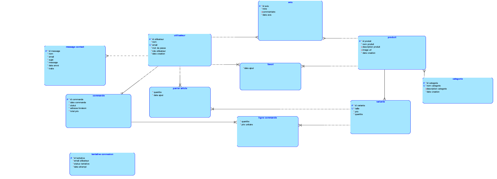
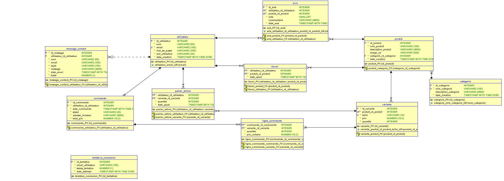

# Base de données AOMI

Base **PostgreSQL** hébergée sur **Supabase**, utilisée depuis le backend **Python** (SQLAlchemy + psycopg 3).

## Modèle

| MCD | MLD |
|---|---|
|  |  |

Le modèle est modifiable avec Oracle SQL Developer Data Modeler (`aomi.dmd`). Le fichier `aomi.dmd` et le dossier `aomi/` vont toujours ensemble : sans le dossier, le modèle s'ouvre vide.

## Tables

| Table | Contenu |
|---|---|
| `utilisateur` | Comptes du site (mot de passe haché) |
| `tentative_connexion` | Historique des connexions, pour limiter les essais |
| `categorie` | Catégories de vêtements |
| `produit` | Vêtements : nom, description, image, catégorie |
| `variante` | Un produit dans une taille, avec son prix et son stock |
| `favori` | Produits ajoutés en favori |
| `panier_article` | Contenu du panier |
| `commande` | Commandes et leur statut (`en_attente`, `payée`, `expediée`, `livrée`, `annulée`) |
| `ligne_commande` | Articles d'une commande, avec le prix payé |
| `avis` | Note (1 à 5) et commentaire, un seul par produit et par personne |
| `message_contact` | Messages du formulaire de contact |

La base refuse d'elle-même les prix à 0, les stocks négatifs, les emails en double et les tailles hors de la liste `XS`, `S`, `M`, `L`, `XL`, `XXL`, `UNIQUE` (en majuscules).

## Rôles

| Rôle | Accès |
|---|---|
| `postgres` | Administrateur du projet Supabase. Sert uniquement à installer la base. |
| `aomi_dev` | L'équipe : tous les droits sur les tables d'AOMI.|
| `aomi_user` | Les clients du site. Droits à définir « À faire ». |

Les comptes personnels ne sont pas dans les fichiers du projet : ils sont créés directement dans Supabase.

## Fichiers

Dans `backend/base_de_donnee/`, à exécuter dans cet ordre :

| Fichier | Rôle |
|---|---|
| `00_roles.sql` | Crée les rôles `aomi_dev` et `aomi_user` |
| `01_schema.sql` | Crée les tables |
| `02_indexes.sql` | Crée les index |
| `03_views.sql` | Vues pour le site — **à finaliser avec `aomi_user`** |
| `04_security.sql` | Active le RLS et ferme l'API publique de Supabase |

Les fichiers 01 à 04 commencent par `SET ROLE aomi_dev;` (avec le point-virgule) pour que les objets créés appartiennent à `aomi_dev`.

## Installation

### 1. Créer le projet Supabase

À la création du projet : désactiver **Enable Data API** et **Automatically expose new tables**, activer **Enable automatic RLS**. Garder le mot de passe de la base dans un gestionnaire de mots de passe, jamais dans un `.env`.

### 2. Exécuter les scripts

Dans **SQL Editor**, pour chaque fichier dans l'ordre : nouvelle requête, coller le contenu, **Run**, attendre « Success » avant de passer au suivant.

### 3. Vérifier

```sql
SELECT 'tables' AS element, count(*) AS nb, 11 AS attendu
FROM pg_tables WHERE schemaname = 'public' AND tableowner = 'aomi_dev'
UNION ALL
SELECT 'index', count(*), 8
FROM pg_indexes WHERE schemaname = 'public' AND indexname LIKE 'idx_%'
UNION ALL
SELECT 'tables avec RLS', count(*), 11
FROM pg_tables WHERE schemaname = 'public' AND rowsecurity;
```

Chaque ligne doit avoir `nb` égal à `attendu`.

## Comptes développeur

La personne qui administre la base crée chaque compte dans SQL Editor, puis supprime la requête (Supabase garde l'historique) :

```sql
CREATE ROLE <prenom> LOGIN PASSWORD '<mot de passe temporaire>' IN ROLE aomi_dev;
```

Chacune remplace ensuite le mot de passe temporaire par le sien. L'adresse se trouve dans Supabase → **Connect** → **Direct** → méthode **Session pooler** : remplacer `postgres.` par `<prenom>.` et retirer `:[YOUR-PASSWORD]`.

**WSL (Ubuntu)**

```bash
sudo apt install -y postgresql-client
psql "postgresql://<prenom>.<ref>@<hote>:5432/postgres?sslmode=require"
```

**Windows (PowerShell)** — installer les *Command Line Tools* de PostgreSQL, puis :

```powershell
& "C:\Program Files\PostgreSQL\18\bin\psql.exe" "postgresql://<prenom>.<ref>@<hote>:5432/postgres?sslmode=require"
```

Une fois connectée : `\password`, puis `\q`.


## Connexion depuis Python

### Configuration

Copier le modèle puis renseigner ses propres valeurs :

```bash
cp .env.example .env              # WSL
Copy-Item .env.example .env       # Windows
```

```
URL_BASE=postgresql://<prenom>.<ref>:<mot de passe>@<hote>:5432/postgres
```

Si le mot de passe contient `@ : / # ?`, il faut l'encoder (`@` devient `%40`).

### Test

**WSL**

```bash
cd ~/Site_Web_aomi
python3 -m venv .venv
source .venv/bin/activate
pip install -r backend/requirements.txt
cd backend && python connexion_test.py
```

**Windows**

```powershell
python -m venv .venv
.venv\Scripts\Activate.ps1
pip install -r backend\requirements.txt
cd backend; python connexion_test.py
```

Résultat attendu :

```
Connectée en tant que : <prenom>
Tables AOMI           : 11
Connexion OK
```

La connexion est gérée par `backend/api/db.py` : il lit `URL_BASE` dans le `.env`, crée le moteur SQLAlchemy et fournit `get_db()`, qui ouvre une session et la ferme après usage.

## Problèmes fréquents

| Erreur | Cause |
|---|---|
| `syntax error at or near "CREATE"` | Point-virgule manquant sur la ligne précédente |
| `password authentication failed` | Mot de passe ou nom `<prenom>.<ref>` incorrect |
| `Tenant or user not found` | Référence du projet incorrecte |
| `Connection timed out` | Connexion directe utilisée au lieu du Session pooler |
| `'NoneType' object has no attribute 'replace'` | `URL_BASE` introuvable : vérifier le `.env` |
| `No module named 'api'` | Le test doit être lancé depuis `backend/` |
| `Activate.ps1` bloqué (Windows) | Utiliser `.venv\Scripts\activate.bat` dans cmd |
| Projet Supabase injoignable | Projet mis en pause (offre gratuite) : **Restore** dans le tableau de bord |

## À faire

- [ ] Vues client (`03_views.sql`) et droits de `aomi_user`
- [ ] Fonctions d'écriture pour `aomi_user` (inscription, panier, commande, avis)
- [ ] `seed.sql` avec des données de test
